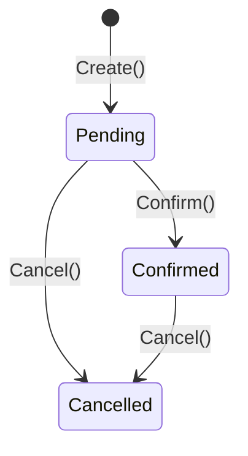
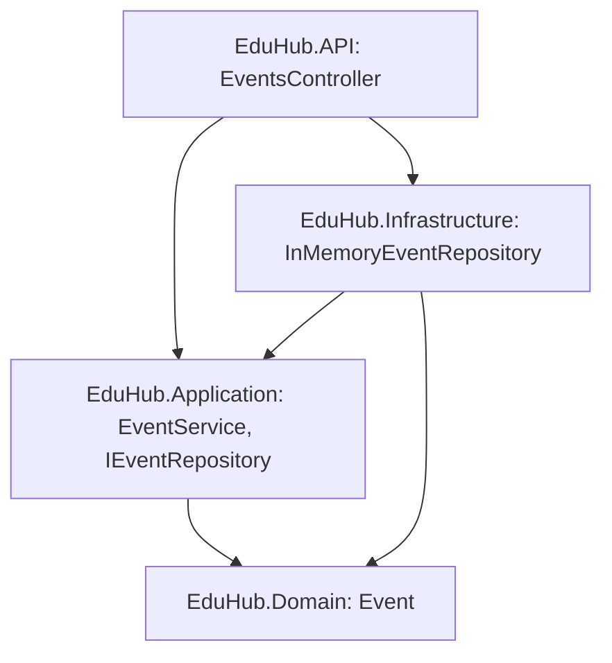

# BÀI KIỂM TRA GIỮA KỲ IN421109
## Câu 1a
1. Đóng gói (Encapsulation): Giúp bảo vệ dữ liệu bên trong đối tượng, không cho phép bên ngoài thay đổi trực tiếp. Minh họa: lớp Member trong file Member.cs, sử dụng private set để bảo vệ thuộc tính.
2. Trừu tượng (Abstraction): Chỉ cung cấp các chức năng cần thiết và ẩn đi cách thực hiện bên trong. Minh họa: interface IEventRepository trong file IEventRepository.cs, định nghĩa các phương thức thao tác với sự kiện.
3. Kế thừa (Inheritance): Cho phép lớp con kế thừa các thuộc tính và phương thức từ lớp cha. Minh họa: lớp EventsController trong file EventsController.cs, kế thừa ControllerBase.
4. Đa hình (Polymorphism): Cho phép các lớp thực hiện cùng một interface nhưng có cách xử lý khác nhau. Minh họa: lớp EmailNotificationService và SmsNotificationService triển khai INotificationService trong các file tương ứng.
## Câu 1b
Vấn đề 1: Thuộc tính Id và Email có public set, cho phép bên ngoài thay đổi dữ liệu trực tiếp, không đảm bảo tính đóng gói.
Vấn đề 2: Constructor public cho phép tạo đối tượng Member không có email hợp lệ, dẫn đến dữ liệu không đúng yêu cầu.
Cách khắc phục: Sử dụng private set, constructor private và factory method Create() để kiểm tra email không rỗng và phải chứa ký tự @.
## Câu 2a

## Câu 3a
1. SRP – Nguyên lý trách nhiệm đơn nhất (dòng 6–14): EventService vừa kiểm tra dữ liệu, lưu sự kiện, ghi log và gửi thông báo, đảm nhận quá nhiều trách nhiệm.
2. OCP – Nguyên lý đóng/mở (dòng 11–14): Khi thêm kênh thông báo mới, phải sửa trực tiếp các câu lệnh if/else trong EventService.
3. DIP – Nguyên lý đảo ngược phụ thuộc (dòng 8, 12, 14): EventService phụ thuộc trực tiếp vào SqlConnection, EmailSender và SmsSender thay vì phụ thuộc vào các interface.
## Câu 4b
Git merge: Gộp các thay đổi từ nhánh khác vào nhánh hiện tại, giữ nguyên lịch sử commit và có thể tạo thêm merge commit.
Git rebase: Chuyển các commit của nhánh hiện tại lên một commit nền mới, giúp lịch sử Git tuyến tính và dễ theo dõi hơn.
Không nên dùng rebase: Khi các commit đã được push lên nhánh dùng chung và có người khác đang làm việc, vì rebase viết lại lịch sử commit, dễ gây xung đột và mất đồng bộ.
## Câu 5a
Clean Architecture gồm 4 lớp, với chiều phụ thuộc hướng từ lớp ngoài vào lớp trong:

## Câu 5b
EduHub.Domain không được tham chiếu tới EduHub.Infrastructure vì theo nguyên lý Clean Architecture, lớp Domain chứa nghiệp vụ cốt lõi và phải độc lập với công nghệ lưu trữ. Nếu Domain phụ thuộc Infrastructure thì khi thay đổi cách lưu dữ liệu sẽ ảnh hưởng đến nghiệp vụ, khiến hệ thống khó bảo trì và kiểm thử.
## Câu 5d
Khi đăng ký InMemoryEventRepository bằng AddScoped, mỗi HTTP request sẽ tạo một instance repository mới. Vì dữ liệu được lưu trong List<Event> không static, nên sau khi POST kết thúc, dữ liệu của instance cũ không được giữ lại cho request GET tiếp theo.
Để khắc phục, em đăng ký IEventRepository với InMemoryEventRepository bằng AddSingleton trong Program.cs. Cách này giúp các request sử dụng chung một instance repository và giữ dữ liệu trong bộ nhớ khi ứng dụng còn chạy.